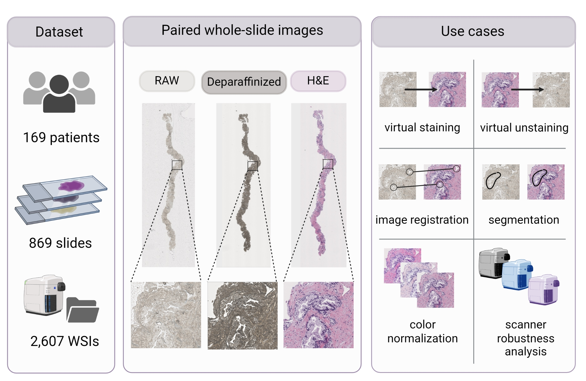
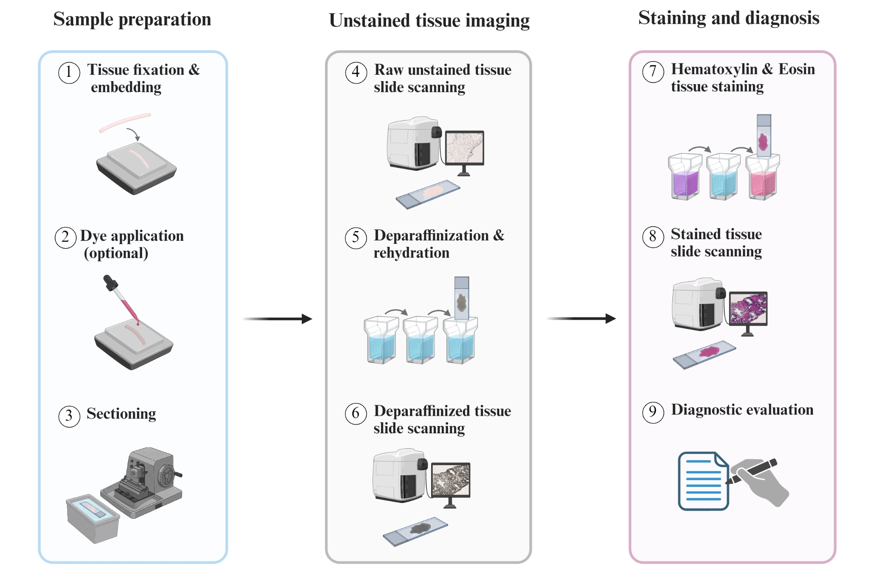

<p align="center">
  
</p>

<h1 align="center">The BRIDGE dataset</h1>

<p align="center">
  <b>Paired brightfield whole-slide images of prostate core-needle biopsies in paraffin, after deparaffinization and H&amp;E staining</b>
</p>

<p align="center">
  <a href="ARXIV_LINK"></a>
  
</p>

<p align="center">
  Julia A. Mielcarz<sup>1</sup>,
  Justyna Durślewicz<sup>2,3</sup>,
  Marek Zdrenka<sup>2</sup>,
  Ahmad Abbadi<sup>1</sup>,
  Martin Eklund<sup>1</sup>,
  Mateusz Matusiak<sup>2,3</sup>,
  Łukasz Szylberg<sup>2,4</sup>,
  Andrea Camilloni<sup>1</sup>
</p>

<p align="center"><sub>
  <sup>1</sup> Department of Medical Epidemiology and Biostatistics, Karolinska Institutet, Stockholm, Sweden<br>
  <sup>2</sup> Department of Tumor Pathology and Pathomorphology, Prof. Franciszek Łukaszczyk Oncology Centre, Bydgoszcz, Poland<br>
  <sup>3</sup> Center for Translational Pathology, Faculty of Medicine, Bydgoszcz University of Science and Technology, Bydgoszcz, Poland<br>
  <sup>4</sup> Department of Obstetrics, Gynaecology and Oncology, Ludwik Rydygier Collegium Medicum in Bydgoszcz, Nicolaus Copernicus University in Toruń, Bydgoszcz, Poland
</sub></p>

<p align="center"><sub>Corresponding author: Julia Mielcarz, <a href="mailto:julia.mielcarz.jm@gmail.com">julia.mielcarz.jm@gmail.com</a></sub></p>

<p align="center">
  <a href="#abstract">Abstract</a> ·
  <a href="#what-can-bridge-be-used-for">Use cases</a> ·
  <a href="#data-availability">Data</a> ·
  <a href="#citation">Citation</a>
</p>

---

## Abstract

Computational approaches are increasingly being explored to streamline histopathology workflows, including label-free methods that aim to reduce reliance on chemical staining. Among these, deep learning-based label-free virtual staining uses images of unstained tissue to computationally generate stained images. Despite growing interest, model development and validation remain constrained by the scarcity of paired, clinically annotated whole-slide imaging datasets. We present BRIDGE, a dataset of prostate core-needle biopsies collected at the Prof. Franciszek Łukaszczyk Oncology Centre in Bydgoszcz, Poland. The dataset comprises 869 glass slides from 169 patients, each digitized sequentially after sectioning, deparaffinization, and hematoxylin and eosin staining, yielding in total 2,607 whole-slide images. The dataset supports the development and external validation of label-free virtual staining, virtual unstaining and image-registration methods. Each slide is accompanied by a Gleason score, enabling downstream analyses of cancer classification and grading concordance. The stained images can be used independently for color normalization and cross-scanner robustness studies. All images are de-identified, distributed in their native scanner format and made available through the BioImage Archive.

<p align="center">
  
</p>

## Summary

| | |
|---|---|
| Tissue | Prostate core-needle biopsies |
| Patients | 169 |
| Glass slides | 869 |
| Whole-slide images | 2,607 |
| Imaging stages per slide | 3 (raw, deparaffinized, H&E) |
| Clinical annotation | Slide-level Gleason score |
| Image format | TIFF-based |
| Access | BioImage Archive (available upon acceptance) |

## What can BRIDGE be used for?

| Use case | Description |
|---|---|
| **Virtual staining** | Development of models that generate H&E images from raw or deparaffinized unstained tissue |
| **Virtual unstaining** | Learning of the inverse mapping, from stained to unstained tissue |
| **External validation** | Evaluation of generative or diagnostic models trained on different patient populations, scanners or tissue-preparation protocols |
| **Image registration** | Development and benchmarking of methods for aligning the same section across processing stages |
| **Tissue segmentation** | Identification of the tissue area at any processing stage, including directly from unstained brightfield images, an important preprocessing step for stain-free pipelines |
| **Cancer classification and grading** | Development and evaluation of classification and Gleason grading models, and assessment of concordance with reported pathological grades, including for stain-free approaches |
| **Color normalization and scanner sensitivity analysis** | Investigation of stain normalization methods and of the sensitivity of computational pathology models to scanner variation |

By releasing paired images of the same prostate sections at three processing stages, together with diagnostic annotations, BRIDGE aims to support the development and independent evaluation of robust stain-free computational pathology methods.

## Data collection

Prostate core-needle biopsies were retrospectively collected at the Prof. Franciszek Łukaszczyk Oncology Centre in Bydgoszcz, Poland. The formalin-fixed, paraffin-embedded (FFPE) tissue blocks were sectioned at 3.5 µm and mounted onto glass slides. In some cases, Safranin O dye was added during paraffin embedding to improve tissue visibility, which results in varying appearance of the raw tissue. Each glass slide was scanned three times with the same VENTANA DP 600 Slide Scanner (Roche Diagnostics) at 40× magnification (0.25 µm/pixel): immediately after sectioning with paraffin retained, after deparaffinization in xylene, and after automated H&E staining. A certified uropathologist then reviewed each H&E-stained slide and assigned a slide-level Gleason score, which was mapped to the corresponding ISUP Grade Group. In addition, each scan was assigned a quality label, and each raw scan a dye intensity label.

<p align="center">
  
</p>
<p align="center"><sub>Overview of the sample collection pipeline.</sub></p>

## Data availability

> [!NOTE]
> The dataset will be made publicly available through the **BioImage Archive** upon acceptance of the accompanying manuscript. The access link will be provided here.

<!-- TODO: describe the folder structure and file naming, e.g.

```
BRIDGE/
├── metadata.csv          # slide ID, patient ID, Gleason score, ...
├── raw/
├── deparaffinized/
└── he/
```
-->

## Citation

If you use BRIDGE in your work, please cite:

> Mielcarz J. A., Durślewicz J., Zdrenka M., Abbadi A., Eklund M., Matusiak M., Szylberg Ł., Camilloni A. *The BRIDGE dataset: Paired brightfield whole-slide images of prostate core-needle biopsies in paraffin, after deparaffinization and H&E staining.* arXiv: [XXXX.XXXXX](ARXIV_LINK), 2026.

```bibtex
@article{mielcarz2026bridge,
  title   = {The {BRIDGE} dataset: Paired brightfield whole-slide images of prostate core-needle biopsies in paraffin, after deparaffinization and {H\&E} staining},
  author  = {Mielcarz, Julia A. and Dur{\'s}lewicz, Justyna and Zdrenka, Marek and Abbadi, Ahmad and Eklund, Martin and Matusiak, Mateusz and Szylberg, {\L}ukasz and Camilloni, Andrea},
  journal = {arXiv preprint arXiv:XXXX.XXXXX},
  year    = {2026},
  url     = {ARXIV_LINK}
}
```

## License

This repository and the BRIDGE dataset are licensed under the [Creative Commons Attribution 4.0 International License (CC BY 4.0)](https://creativecommons.org/licenses/by/4.0/).
